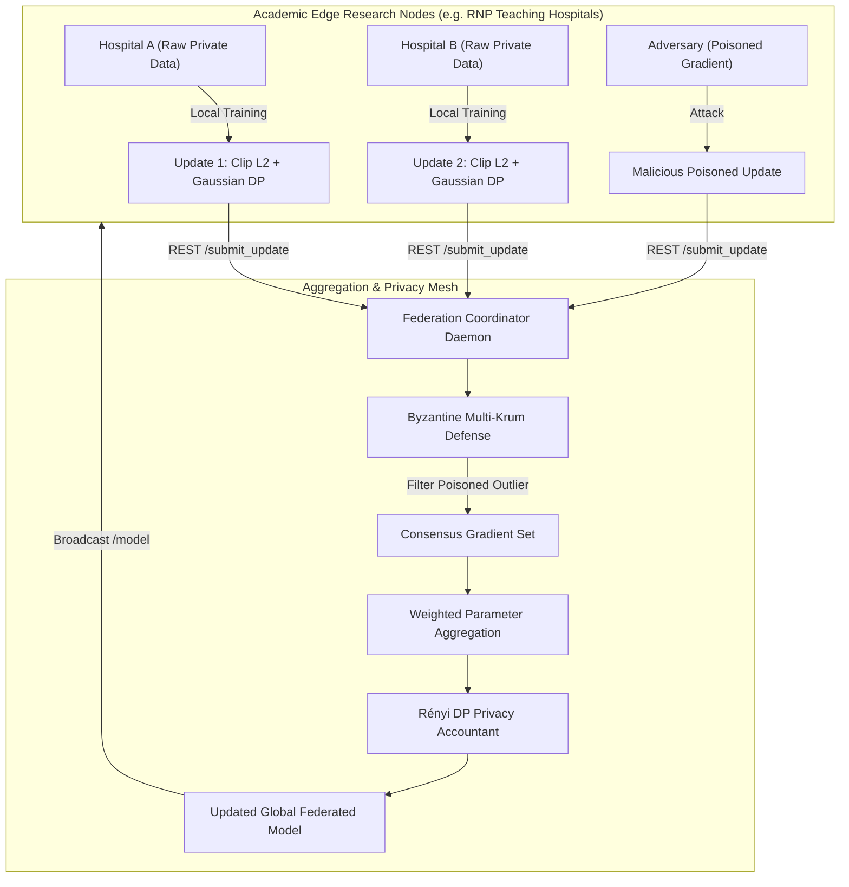

# federated-learning-privacy-mesh

[](https://github.com/FelipeMadson/federated-learning-privacy-mesh/actions)
[](LICENSE)
[](https://www.python.org/)
[](pyproject.toml)

> High-Performance Federated Learning Orchestration Mesh with Provable Rényi Differential Privacy and Byzantine-Robust Multi-Krum Secure Aggregation, implemented in 100% pure Python with zero third-party dependencies.

Architected and maintained by **[Felipe Madison](https://github.com/FelipeMadson)** to enable cross-institutional collaborative AI and private research data spaces (such as RNP Data Spaces, academic hospital consortia, and genomic databases) without exposing raw patient data or allowing model inversion attacks.

---

## 🚀 Key Architectural Highlights

1. **Provable $(\epsilon, \delta)$-Differential Privacy (DP)**:
   - **$L_2$ Gradient Norm Clipping**: Enforces sensitivity bounds $C$ on edge updates before transmission.
   - **Calibrated Gaussian Perturbation Mechanism**: Injects Gaussian noise scaled to the sensitivity bound $\sigma = \text{multiplier} \cdot C$.
   - **Rényi Privacy Accountant**: Calculates rigorous cumulative epsilon expenditure across federation rounds via the Advanced Composition Theorem.

2. **Byzantine-Robust Multi-Krum Secure Aggregation**:
   - Outlier detection and filtering tolerant to up to $f$ adversarial or malicious edge nodes ($n \ge 2f + 3$).
   - Computes pairwise Euclidean distances and sums distances to $n - f - 2$ closest consensus neighbors, completely immunizing the global model against gradient poisoning or sybil inversion attacks.
   - Alternate strategies include standard sample-weighted **FedAvg** and coordinate-wise **Trimmed Mean**.

3. **Autonomous HTTP REST Federation Coordinator Daemon**:
   - Zero-dependency REST server built directly on `http.server.HTTPServer`.
   - Endpoints:
     - `GET /health` — Health check status.
     - `GET /model` — Current global model parameters and round number.
     - `GET /metrics` — Active research nodes, cumulative privacy expenditure $(\epsilon, \delta)$, and round telemetry.
     - `POST /register` — Research node onboarding.
     - `POST /submit_update` — Client update ingestion with automatic privacy validation.
     - `POST /finalize_round` — Executes secure aggregation and updates the global weights.

4. **100% Zero Third-Party Dependencies**:
   - Built entirely with Python 3.12 standard libraries (`math`, `random`, `dataclasses`, `typing`, `http.server`, `json`, `unittest`).
   - Lightning-fast setup, zero Docker bloat, and instant deterministic testing.

---

## 🏛️ System Architecture



---

## 🛠️ Verification & Test Suite

Run the full automated test suite using Python's standard `unittest`:

```bash
python -m unittest discover tests
```

### Passing Tests

```text
Ran 8 tests in 0.001s

OK
```

---

## 📜 License

MIT License. Designed and maintained by [Felipe Madison](https://github.com/FelipeMadson).
